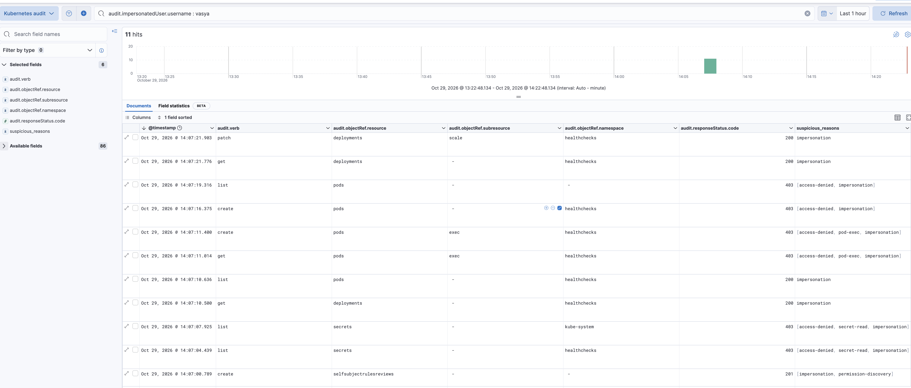
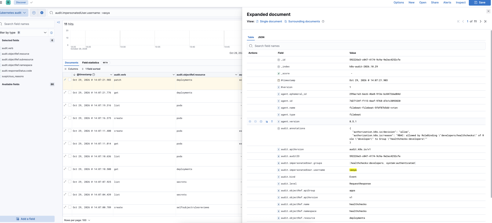
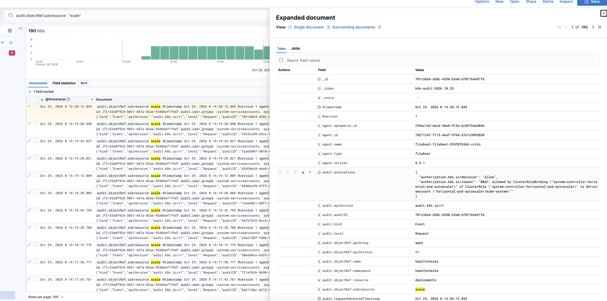
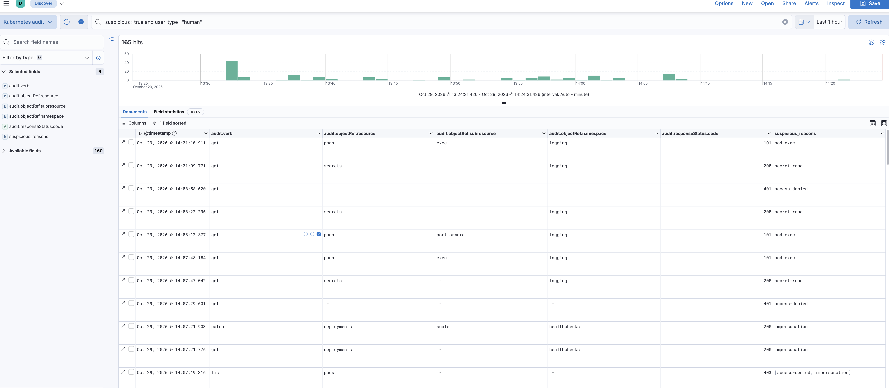

## 1. Architecture

```
kube-apiserver (EKS) ──▶ CloudWatch Logs  /aws/eks/healthchecks/cluster  (kept 30 days)
                               │ IAM role (IRSA), read-only
                               ▼
   Filebeat ──▶ Logstash ──▶ Elasticsearch ──▶ Kibana   (namespace "logging", dedicated node)
               parse + detection rules                   (port-forward only)
```

- **CloudWatch** keeps the original log outside the cluster, so it can't be changed even if the cluster is compromised.
- **Filebeat** reads from CloudWatch, because on EKS the audit log is not a file on our nodes.

## 2. Setup

### 2.1 Enable audit logging (`infra/eks-cluster.yaml`)

On EKS, AWS runs the API server and applies its own audit policy, which records all requests and logs Secrets at `Metadata` level. The policy can't be changed; enabling the log type is enough:

```yaml
cloudWatch:
  clusterLogging:
    enableTypes: ["audit", "authenticator"]
    logRetentionInDays: 30
```

On a self-managed cluster (kubeadm, k3s) you would instead pass your own policy to the API server with `--audit-policy-file` and `--audit-log-path`.

### 2.2 Cluster prerequisites (`infra/eks-cluster.yaml`)

- node group `logging` (1 × **m7i-flex.large**, 8 GiB, tainted `dedicated=logging:NoSchedule`) for the ELK stack
- `aws-ebs-csi-driver` add-on with a default StorageClass, for the Elasticsearch disk
- IRSA ServiceAccount `logging/filebeat`, allowed only to read the cluster's log group

The account is on the AWS Free Tier plan, which only allows some instance types; `t3.large` was rejected (`InstanceType is not eligible for Free Tier`), so `m7i-flex.large` (same CPU and memory) is used.

### 3.3 ELK stack

| File | Purpose |
|---|---|
| `values/elasticsearch.yaml` | single node, TLS + password, 20 GiB EBS, NetworkPolicy, no privileged container |
| `values/logstash-config.yaml` | pipeline (parse, enrich, detection rules) and the index template |
| `values/filebeat.yaml` | Deployment with the `aws-cloudwatch` input → Logstash |
| `values/kibana.yaml` | ClusterIP only |
| `helm_secrets/elastic_secret.yaml` | `elastic` password (sops-encrypted), fixed across upgrades |

All four are releases in `helmfile.yaml` with the label `tier=logging`:

```bash
helmfile -l tier=logging apply
kubectl get pods -n logging
```

The `logging` namespace enforces Pod Security `baseline` and warns/audits `restricted`.

### 3.4 Open Kibana

```bash
kubectl get secret -n logging elasticsearch-master-credentials -o jsonpath='{.data.password}' | base64 -d
kubectl port-forward -n logging svc/kibana-kibana 5601:5601
```

Open http://localhost:5601, log in as `elastic`, and create a data view for `k8s-audit-*` with time field `@timestamp`.

### 3.5 Problems found during deployment

| Problem | Cause | Fix |
|---|---|---|
| Filebeat `CrashLoopBackOff`: `open filebeat.yml: permission denied` | The chart mounts the config with mode `0600`, owned by root; Filebeat ran as uid 1000 | Filebeat runs as root (chart default), with all capabilities dropped, no privilege escalation, seccomp; allowed by `baseline`, flagged by the `restricted` warning |
| ~5% of events rejected: `Limit of total fields [1000] has been exceeded` | Elasticsearch created a field for every key in `requestObject` / `responseObject` (every resource type has different fields) | Index template: bodies stored but not indexed (`enabled: false`), annotations `flattened`, key fields `keyword`, `source_ip` as `ip`. Fields dropped from 1000+ to 128, index green |
| Thousands of false positives | See section 4 (tuning) | Rules tuned |
| `helmfile destroy` hung on Kibana: `post-delete-kibana-kibana` job `ETIMEDOUT` to port 9200 | The Elasticsearch NetworkPolicy allowed Kibana's pre-install job but not its post-delete cleanup job | Added `job-name: post-delete-kibana-kibana` to the NetworkPolicy rules |

## 4. Parsing and detection

Logstash:
- parses each event into `audit.*` fields
- sets `@timestamp` to when the request happened
- adds `source_ip` and `user_type` (`human` / `serviceaccount` / `system`)
- drops lease heartbeats from control-plane components as noise (they remain in CloudWatch)
- uses `auditID` as the document ID, so re-reading the logs never creates duplicates

Each matching rule adds a reason to `suspicious_reasons` and sets `suspicious: true`:

| Reason | Rule |
|---|---|
| `access-denied` | response `401` / `403` |
| `secret-read` | a human reads Secrets |
| `pod-exec` | `exec`, `attach`, `portforward` |
| `rbac-change` | write to RBAC objects |
| `security-control-deleted` | delete of NetworkPolicy or Namespace |
| `impersonation` | a human makes a request with `--as` |
| `permission-discovery` | a human runs `kubectl auth can-i --list` |
| `anonymous-access` | unauthenticated request, except health checks |

**Tuning.** The first version of the rules flagged ~6,000 events on an idle cluster:

| Flag | Real cause | Change |
|---|---|---|
| `anonymous-access` | EKS health checks of `/healthz`, `/livez`, `/readyz` from `127.0.0.1` and `ELB-HealthChecker` | ignore the health endpoints |
| `impersonation` | `AWSServiceRoleForAmazonEKS` (EKS event service, cluster insights) impersonating its own users | AWS service roles count as `system`; impersonation is only flagged for humans |

What remained was explainable: RBAC objects created by `eks:cluster-bootstrap` at startup, denials of control-plane components during startup, and the operator's own `kubectl get secret` for the Elasticsearch password.

Useful Kibana queries:

```
suspicious : true and user_type : "human"
audit.impersonatedUser.username : vasya
audit.objectRef.resource : "secrets" and not user_type : "system"
audit.objectRef.subresource : "scale" and user_type : "human"
```

**Routine:** review `suspicious : true and user_type : "human"` daily, and alert on ≥ 3 `access-denied` events from one identity within 5 minutes.

## 5. Exercise: suspicious activity

**Scenario (hypothetical).** A developer's credentials are stolen. The attacker uses them to explore the cluster, tries to steal secrets, and causes damage with whatever is allowed.

**Reproduced on the live cluster** by impersonating a developer: `kubectl --as=vasya --as-group=healthchecks:developers ...`. The API server applies the `developer` RBAC role exactly as for a real member of the group. Times below are local (UTC+2), as shown in Kibana.

### Step 1: everything this identity did

Query `audit.impersonatedUser.username : vasya`:



| Time | Action | Code | Flags |
|---|---|---|---|
| 14:07:00 | `auth can-i --list` | 201 | permission-discovery |
| 14:07:04 | list secrets in `healthchecks` | **403** | access-denied, secret-read |
| 14:07:07 | list secrets in `kube-system` | **403** | access-denied, secret-read |
| 14:07:11 | exec into the app pod | **403** | access-denied, pod-exec |
| 14:07:16 | create own pod | **403** | access-denied |
| 14:07:19 | list pods in all namespaces | **403** | access-denied |
| 14:07:21 | **scale deployment `healthchecks` to 0** | **200** | — |

All events also carry `impersonation`. A few minutes earlier there was a burst of denials from a malformed username (the shell passed `vasya --as-group=...` as one string): a failed first attempt that is also visible in the log.

### Step 2: why was the last action allowed?



The annotation shows the exact reason: *"RBAC: allowed by RoleBinding `developers/healthchecks` of Role `developer` to Group `healthchecks:developers`"*. The request body (`audit.requestObject`) contains the new replica count.

### Step 3: is it really the developer?

On the live cluster the "attacker" is impersonation by the operator. With real stolen credentials, the signs would be:
- a source IP never seen for this identity
- a different OS in the user agent
- unusual time
- a classic attacker sequence: discover permissions → Secrets → shell → own pod

The Kubernetes username contains the IAM role and session, so **CloudTrail** (`AssumeRole`) shows from where and whether MFA was used.

### Step 4: impact

- RBAC blocked every attempt to read Secrets, exec, create pods, or leave the namespace, so **no data was accessed**.
- The `developer` role allowed scaling, so **the application was down** (0/0 replicas) until it was scaled back to 2.

### Step 5: response and lessons

- revoke the role's sessions and deactivate the stolen key; scale the app back; check the same IP for other activity
- require MFA and a source-IP condition to assume roles
- forbid `replicas: 0` for the app (ValidatingAdmissionPolicy), or remove `scale` from the developer role
- alert on bursts of denials: the 5 denials within 20 seconds would have alerted before the damage

## 6. Insights

1. **Denied requests are the strongest signal.** Normal users rarely get `403`. RBAC turned the attack into a visible series of denials, and the damaging action came after them.
2. **Look at the whole session, not only alerts.** The damaging `scale` was *allowed* and matched no rule. It was found by pivoting on the identity.
3. **Filter by who, not only by what.** `subresource : "scale"` returns 190 events, almost all from the HPA controller every 15 seconds; the attacker's single event is invisible until filtered by `user_type : "human"`:

   

4. **The first rules are always noisy.** Health checks and AWS's own service roles produced thousands of false positives. Tuning against real data is part of the setup.
5. **The analyst is in the log too.** Reading the Elasticsearch password and port-forwarding to Kibana appear as `secret-read` and `pod-exec` from the operator's IAM user. In a real team someone would confirm these were expected:

   

6. **Correlate with CloudTrail.** The audit log shows *what* happened in the cluster; CloudTrail shows *how* the identity got in.

## 7. Security of the logging stack and limitations

**Security:**
- TLS and authentication on Elasticsearch, with the password encrypted in Git
- Kibana is not exposed (port-forward only)
- Filebeat uses a read-only IAM role, with no AWS keys in the cluster
- Elasticsearch, Logstash and Kibana run as non-root with all capabilities dropped

**Limitations:**
- Filebeat runs as root (chart limitation, see 3.5); the Kibana setup job can't be hardened, so the namespace enforces `baseline`
- the `elastic/*` Helm charts are deprecated (8.5.1 is the last release); use ECK or a managed service in production
- Elasticsearch runs as a single node; Logstash writes as the `elastic` superuser

## Cleanup

```bash
helmfile -l tier=logging destroy
kubectl delete pvc -n logging elasticsearch-master-elasticsearch-master-0
eksctl delete nodegroup --cluster healthchecks --name logging --approve
```
